# HW2: Multiple Linear Regression: Human-AI Interaction

## AIoT-DA 課程 — HW 2 專案說明文件


📚 實作資訊
- **課程名稱**: AIoT 
- **作業實作**: HW-2 — Multiple Linear Regression: Human-AI Interaction
- **示範教師**: Huan Chen
- **學生 Live Demo Page**: 
- **學生儲存庫網址**: [https://github.com/PecoRun/AIoT-HW2-MultipleLR](https://github.com/PecoRun/AIoT-HW2-MultipleLR)

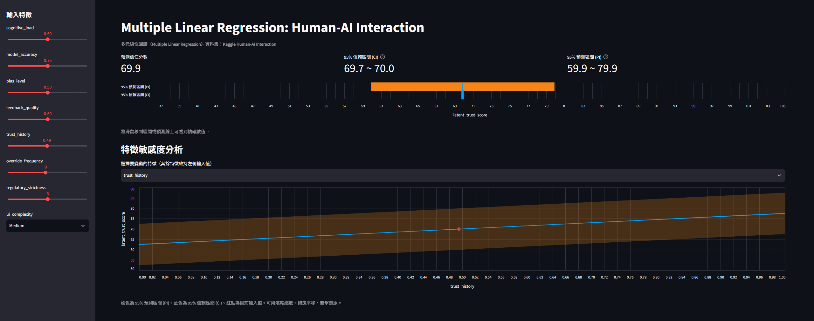
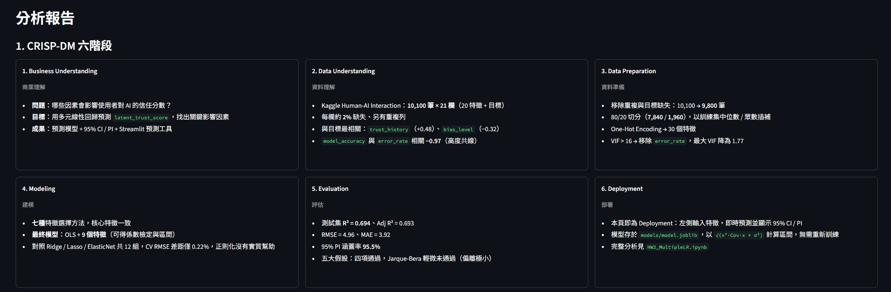
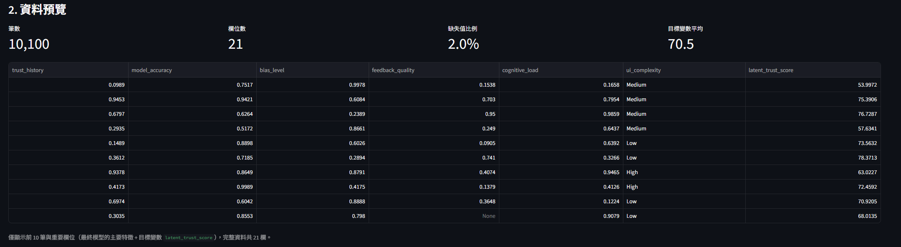
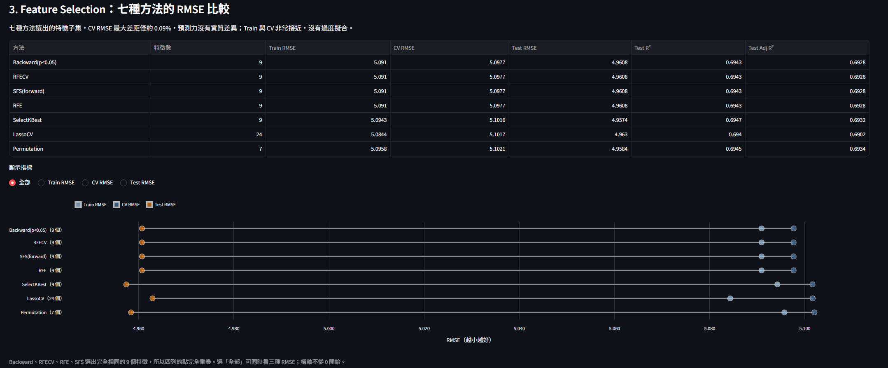
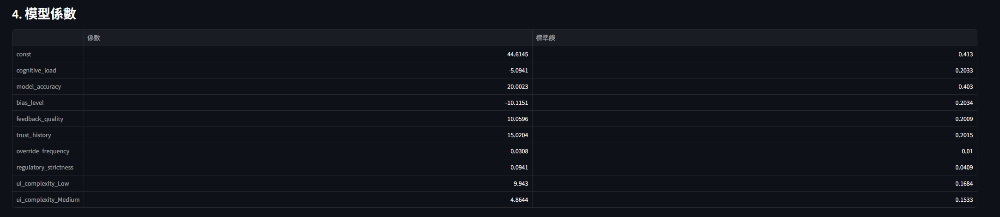
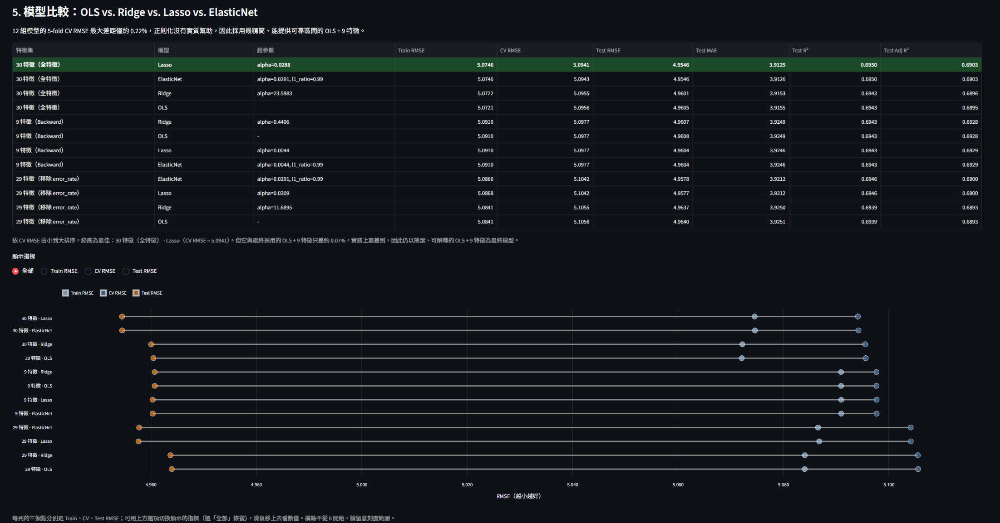
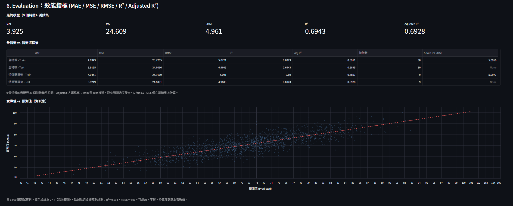
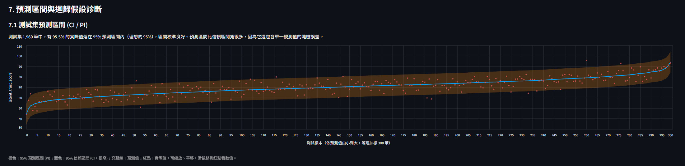
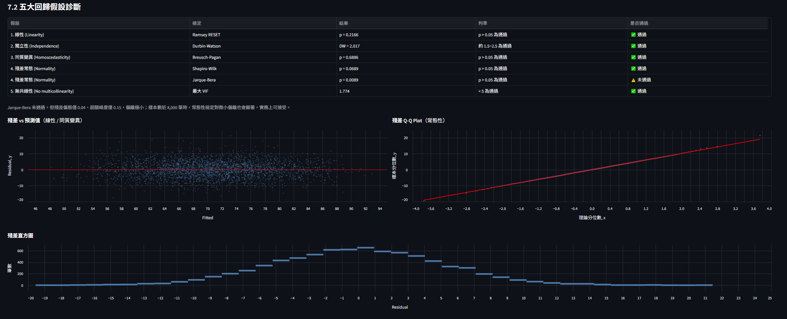


以 **Multiple Linear Regression** 分析 Kaggle 的 Human-AI Interaction 資料集，依 **CRISP-DM** 流程完成 Business Understanding → Data Understanding → Data Preparation → Modeling → Evaluation → Deployment。

- **資料集**：[Human-AI Interaction（Kaggle）](https://www.kaggle.com/datasets/eshaalnmalik/human-ai-interaction/data)
- **授權**：[CC0 1.0 Universal（Public Domain Dedication）](https://creativecommons.org/publicdomain/zero/1.0/)，可自由複製、修改與散布，因此 `data/` 內附有資料檔
- **目標變數**：`latent_trust_score`（使用者對 AI 的潛在信任分數，0~100）
- **規模**：10,100 筆、20 個特徵（14 數值 + 6 類別）

## 專案結構

```
├── HW2_MultipleLR.ipynb     # 完整分析（含輸出結果）
├── app.py                   # Streamlit 預測 App（Deployment）
├── data/Human-AI_Interaction.csv
├── models/model.joblib      # Notebook 訓練後輸出的模型
├── images/                  # README 用圖
├── requirements.txt         # Streamlit App 所需套件（版本已鎖定）
└── requirements-notebook.txt  # 重新執行 Notebook 所需套件（含 App 的依賴）
```

## 執行方式

> 開發與測試環境為 Python 3.14；套件版本已鎖定，因為 `models/model.joblib` 內含 pandas / numpy 物件，版本不同可能無法載入。

**只想執行 App**（不需要重新訓練）：

```bash
pip install -r requirements.txt
python -m streamlit run app.py
```

**重新執行完整分析**（會重新產生 `models/model.joblib`）：

```bash
pip install -r requirements-notebook.txt
jupyter notebook HW2_MultipleLR.ipynb
```

> Windows 若出現「找不到 streamlit 指令」，請使用 `python -m streamlit run app.py`。

## Streamlit App

互動式預測工具，同時整理了整份分析的重點。

<!-- 線上 Demo 網址（部署後補上）：[點此開啟](https://...) -->

**預測區**
- 左側輸入特徵（滑桿與下拉選單），即時顯示**預測信任分數**，以及 **95% 信賴區間 (CI)** 與 **95% 預測區間 (PI)**
- **特徵敏感度分析**：選一個特徵變動，其餘維持輸入值，觀察預測值與區間如何變化（互動圖，可縮放、平移）

**分析報告區**（依序為）
1. CRISP-DM 六階段摘要
2. 資料預覽（重要欄位的前 10 筆）
3. Feature Selection：七種方法的 Train / CV / Test RMSE 比較
4. 模型係數
5. 模型比較：OLS vs. Ridge vs. Lasso vs. ElasticNet（依 CV RMSE 由小到大排序，最佳者標示綠底）
6. Evaluation：MAE / MSE / RMSE / R² / Adjusted R² 與實際值 vs. 預測值散點圖
7. 預測區間與迴歸假設診斷：測試集 CI / PI 預測圖、五大假設檢定與殘差診斷圖

<!-- 截圖（補上後取消註解）：

-->

## CRISP-DM 流程

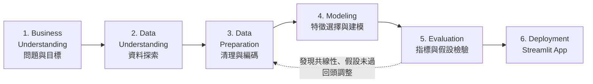

### 1. Business Understanding（商業理解）
- **問題**：哪些因素（模型表現、使用者特性、任務環境）會影響使用者對 AI 的信任分數？能否用這些因素預測 `latent_trust_score`？
- **目標**：建立多元線性回歸模型、找出關鍵影響因素、提供含信賴區間 / 預測區間的預測，並部署成互動工具
- **成功標準**：測試集 R² 明顯優於只用平均值預測（R² = 0），且模型符合主要回歸假設、結果可解釋

### 2. Data Understanding（資料理解）
- 10,100 筆、21 欄（20 個特徵 + 目標變數）；每欄約 2% 缺失值，另有重複列
- 與目標最相關：`trust_history`（+0.48）、`bias_level`（−0.32）、`feedback_quality`（+0.31）、`model_accuracy`（+0.31）、`error_rate`（−0.31）
- `model_accuracy` 與 `error_rate` 相關係數 −0.97，高度共線
- 多數特徵為 0~1 均勻分布，疑似模擬資料；目標變數上限為 100（可能截尾）

### 3. Data Preparation（資料準備）
1. 移除重複列與目標缺失列（10,100 → 9,800 筆）
2. **先切分** 80/20（訓練 7,840 / 測試 1,960），**再**以訓練集的中位數 / 眾數插補，避免 data leakage
3. One-Hot Encoding（`drop_first=True`）→ 30 個特徵
4. **共線性處理**：`model_accuracy` 與 `error_rate` 的 VIF 皆 > 16，移除 `error_rate` 後最大 VIF = 1.77

### 4. Modeling（建模）
- **Feature Selection**：七種方法交叉比對（Backward Elimination、LassoCV、RFECV、SelectKBest、RFE、Sequential Feature Selection、Permutation Importance），核心特徵一致，最終採 Backward Elimination 的 9 個特徵（見下方「Feature Selection：七種方法比較」）
- **最終模型**：`statsmodels.OLS`（可得到係數檢定與區間），並以 `sklearn.LinearRegression` 作為比較基準
- **對照模型**：Ridge / Lasso / ElasticNet 驗證正則化是否有幫助（見下方「模型比較」）

### 5. Evaluation（評估）
- 指標：MAE / MSE / RMSE / R² / Adj R²，以及 5-fold CV RMSE（見下方「結果」）
- 五大回歸假設檢驗：線性、獨立性、同質變異、殘差常態、無共線性（見下方「五大回歸假設」）
- 預測圖：含 95% 信賴區間 (CI) 與預測區間 (PI)，以及實際值 vs. 預測值（見下方「預測圖」）

### 6. Deployment（部署）
- Streamlit App：輸入特徵即時預測，並顯示 95% CI 與 PI（見上方「Streamlit App」）
- 模型係數、共變異數矩陣與殘差變異存於 `models/model.joblib`，App 以 `√(xᵀ·Cov·x + σ²)` 計算預測區間，不需重新訓練

## 結果

| 模型 | 資料 | 特徵數 | MAE | MSE | RMSE | R² | Adj R² | 5-fold CV RMSE |
|---|---|---|---|---|---|---|---|---|
| 全特徵 | Train | 30 | 4.034 | 25.727 | 5.072 | 0.692 | 0.691 | 5.096 |
| 全特徵 | Test | 30 | 3.916 | 24.607 | 4.960 | 0.694 | 0.690 | - |
| **特徵選擇後（最終）** | Train | 9 | 4.045 | 25.918 | 5.091 | 0.690 | 0.690 | 5.098 |
| **特徵選擇後（最終）** | **Test** | **9** | **3.925** | **24.609** | **4.961** | **0.694** | **0.693** | - |

9 個特徵的表現與 30 個特徵相同，剔除的變數沒有額外預測力。測試集有 95.5% 的實際值落在 95% 預測區間內。

### Feature Selection：七種方法比較

| 方法 | 類型 | 保留數 | Train RMSE | CV RMSE | Test RMSE | Test Adj R² |
|---|---|---|---|---|---|---|
| **Backward Elimination（p < 0.05）** | 統計檢定 | 9 | 5.0910 | 5.0977 | 4.9608 | 0.6928 |
| RFECV | Wrapper | 9 | 5.0910 | 5.0977 | 4.9608 | 0.6928 |
| RFE | Wrapper | 9（指定） | 5.0910 | 5.0977 | 4.9608 | 0.6928 |
| Sequential Feature Selection | Wrapper | 9（指定） | 5.0910 | 5.0977 | 4.9608 | 0.6928 |
| SelectKBest | Filter | 9（指定） | 5.0943 | 5.1016 | 4.9574 | 0.6932 |
| LassoCV | Embedded | 24 | 5.0844 | 5.1017 | 4.9630 | 0.6902 |
| Permutation Importance | 模型無關 | 7 | 5.0958 | 5.1021 | 4.9584 | 0.6934 |

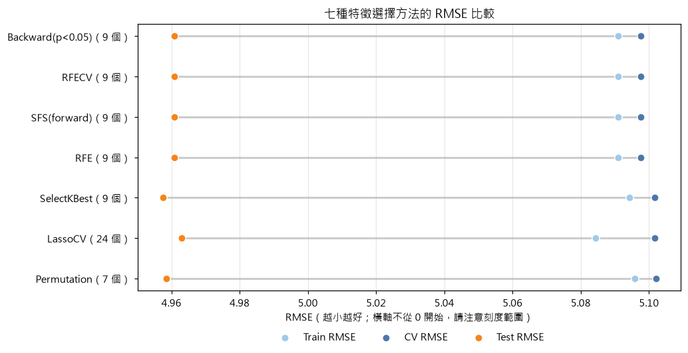

- **全部七種方法都選中**：`trust_history`、`model_accuracy`、`bias_level`、`feedback_quality`、`cognitive_load`、`ui_complexity`。
- Backward、RFECV、RFE、SFS 選出**完全相同的 9 個特徵**；`override_frequency`、`regulatory_strictness` 在統計上顯著但效果量極小，SelectKBest 與 Permutation Importance 因此沒選。
- 七組的預測表現差距不到 0.1%，沒有實質差別，最終採用能對應 OLS 係數檢定的 Backward Elimination。

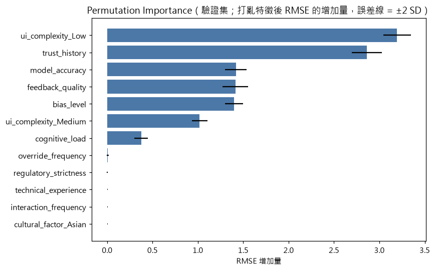

### 模型比較：OLS vs. Ridge vs. Lasso vs. ElasticNet

三組特徵集（30 / 29 / 9 個特徵）× 四種模型共 12 組，正則化模型的超參數以 5-fold CV 選定，並以 nested CV 評估：

| 特徵集 | OLS | Ridge | Lasso | ElasticNet |
|---|---|---|---|---|
| 30 特徵（全特徵） | 5.0956 | 5.0955 | 5.0941 | 5.0943 |
| 29 特徵（移除 `error_rate`） | 5.1056 | 5.1055 | 5.1042 | 5.1042 |
| **9 特徵（Backward）** | **5.0977** | 5.0977 | 5.0977 | 5.0977 |

（表中數值為 5-fold CV RMSE，越小越好；圖為 Train / CV / Test 三種 RMSE，橫軸不從 0 開始）

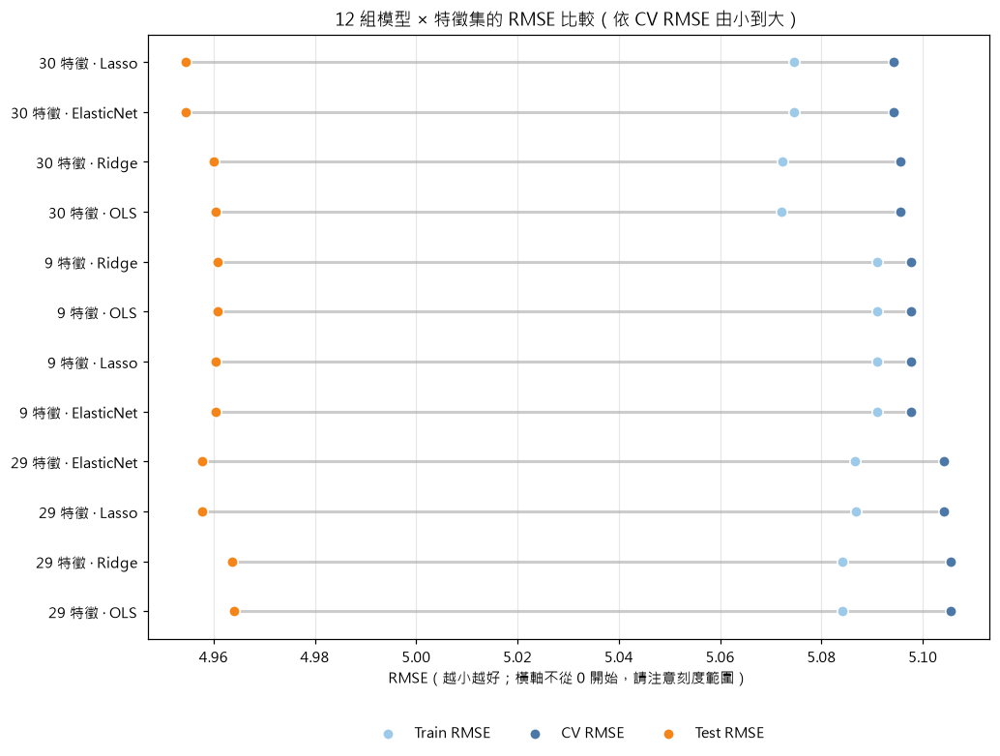

12 組的最大差距只有約 0.22%，**正則化沒有實質幫助**：樣本數遠大於特徵數且共線性已處理，OLS 本身不會過度擬合。因此採用最精簡、可解釋，並能給出可靠信賴區間 / 預測區間的 **OLS + 9 特徵**。移除 `error_rate` 讓 CV RMSE 約增加 0.2%，換來 VIF 從 16 降到 1.77，這個取捨值得。

**影響信任分數的因素**（其餘特徵固定）：`trust_history`（+15.0）、`model_accuracy`（+20.0）、`feedback_quality`（+10.1）為正向；`bias_level`（−10.1）、`cognitive_load`（−5.1）為負向；介面複雜度越低信任越高（Low +9.9、Medium +4.9，相對 High）。

### 五大回歸假設

| 假設 | 檢定 | 結果 |
|---|---|---|
| 線性 | Ramsey RESET | p = 0.217 ✅ |
| 獨立性 | Durbin-Watson | 2.017 ✅ |
| 同質變異 | Breusch-Pagan | p = 0.689 ✅ |
| 殘差常態 | Shapiro-Wilk / Jarque-Bera | p = 0.069 ✅ / p = 0.009 ⚠️（偏態 0.04、峰度 0.15，偏離極小，實務上可接受） |
| 無共線性 | 最大 VIF | 1.77 ✅ |

### 預測圖（95% 信賴區間 CI 與預測區間 PI）

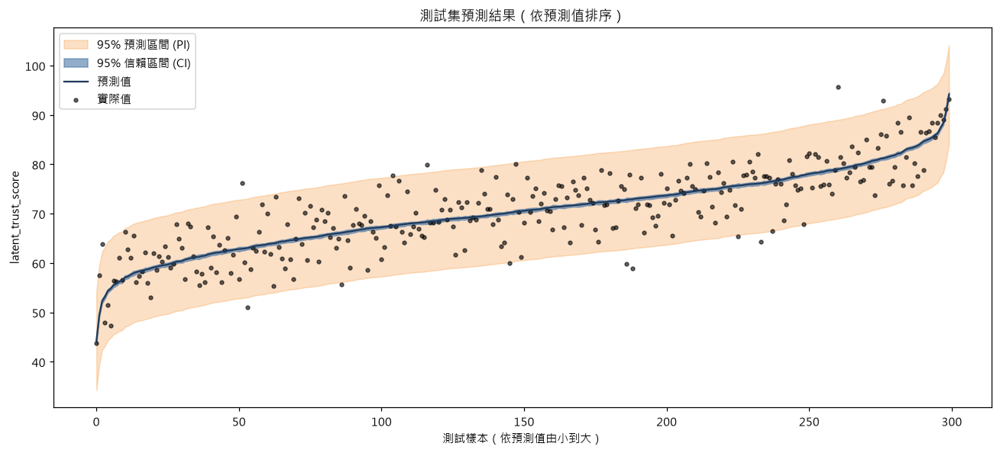

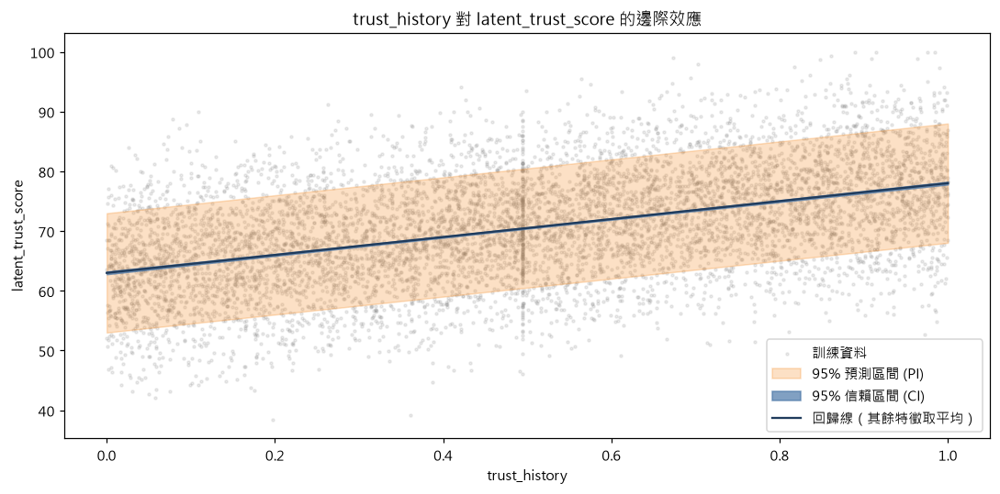

### 實際值 vs. 預測值（測試集）

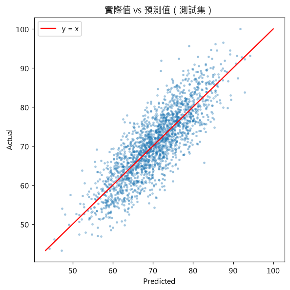

### 殘差診斷

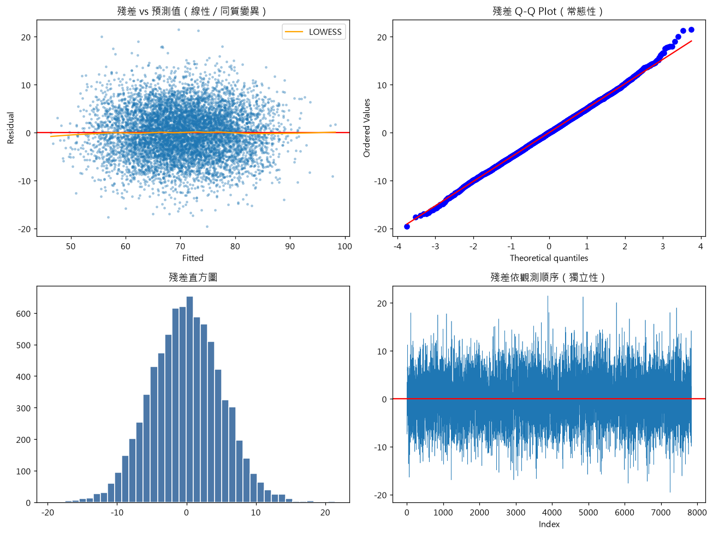

## 限制

- 多數特徵為 0~1 均勻分布，資料疑似為模擬資料，結論不宜直接推論到真實使用者。
- 目標變數上限為 100（可能有截尾）；模型約解釋 69% 變異。
- 回歸係數代表關聯性，不代表因果。
